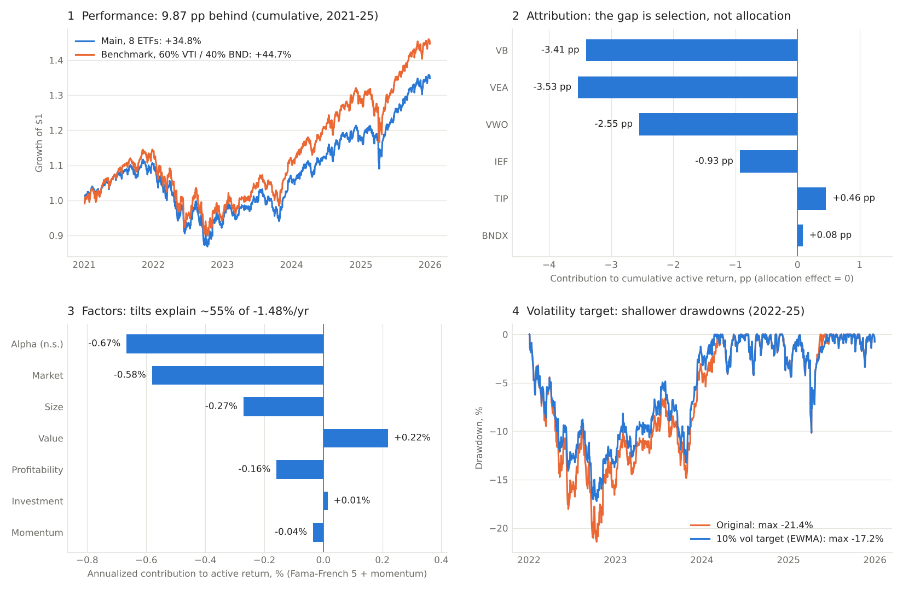

# 投资组合绩效与风险分析

[](https://github.com/wangggggg88/portfolio_project/actions/workflows/tests.yml)

*个人项目 · Python、pandas、NumPy、SQLite · 8 只美元计价 ETF，2021–2025* · [English](README.md)



## 目标

一个分散化的 8 只 ETF、股债 60/40 组合，在 2021–2025 年累计收益 **34.81%**；简单的 60% VTI / 40% BND 基准为 **44.68%**。项目回答三个问题：

1. 在正确计算收益（权重漂移、月度再平衡、交易成本）之后，**差距有多大**？
2. **为什么落后**：是配置、选择，还是因子暴露？
3. **什么能预测、能控制**：收益，还是只有风险？

## 数据

- **价格**：8 只 ETF 的每日复权收盘价，来自 Yahoo Finance（2020-12-31 至 2025-12-31），保存为带校验值的快照。
- **因子**：Fama-French 五因子、动量和短期国债利率，来自 Kenneth R. French Data Library。
- **假设的部分**：只有组合权重。它是研究设计，不是真实账户；价格和收益都没有模拟。

## 方法

| 步骤 | 回答的问题 | 方法 |
|---|---|---|
| 1. 度量 | 差距多大，对成本是否敏感？ | 日度回测，权重自然漂移，每月下一交易日再平衡，成本 0 / 5 / 10 bps |
| 2. 归因 | 配置还是选择？ | 按月做 Brinson-Fachler，用 Carino 系数链接到 5 年 |
| 3. 风险分解 | 风险集中在哪里？ | 波动率和跟踪误差的 Euler 贡献；VaR / ES，用 Kupiec 和 Christoffersen 检验 |
| 4. 解释 | 是能力还是因子暴露？ | Fama-French 五因子加动量，日度数据，Newey-West 标准误 |
| 5. 预测 | 波动率能否样本外预测？ | 6 个模型（63/252 日、EWMA、GARCH、GJR-GARCH、HAR），每 21 个交易日重估，用 QLIKE 和 Diebold-Mariano 检验 |
| 6. 应用 | 预测有没有用？ | 过滤历史模拟（FHS）VaR；不加杠杆的 10% 波动率目标 |

**逻辑链条**：两个组合每月初都是 60/40，所以差距只能来自股票和债券内部持有的是什么。归因指出差距在哪里（小盘和国际股票）；因子回归再检验这是否就是较低的市场 beta 和小盘暴露，还是有无法解释的部分。收益方向无法预测，所以最后一部分检验风险能否预测，以及预测是否有用。

## 主要结果

- **差距**：累计 −9.87 pp（34.81% 对 44.68%）。跟踪误差 2.27%，信息比率 −0.65。10 bps 成本下只多损失 0.27 pp。
- **归因**：配置效应恰好为 0，差距全部来自选择效应。股票段 −9.49 pp（VB −3.41、VEA −3.53、VWO −2.55），债券段 −0.39 pp。
- **风险**：股票权重 60%，却贡献约 91% 的组合波动；VTI 低配贡献约 86% 的跟踪误差。
- **因子**：年化主动收益 −1.48%，约 55% 来自因子暴露，主要是美国市场 beta 偏低（0.55 对 0.61）和小盘暴露。剩余 alpha（−0.67%，t = −0.9）不显著。
- **波动率预测**：对近期波动反应快的模型更好。252 日窗口在 20 次检验中有 16 次显著差于 EWMA；GJR-GARCH 对组合排名第一，但优势不显著。
- **VaR**：99% VaR 只有在「反应快的模型 + FHS」时才能通过 Kupiec 检验（4 个全部通过，例如 EWMA 例外 12 次，期望 10 次）。用正态分位数时 4 个中 2 个失败；慢速窗口无论哪种方法都失败。
- **波动率目标**（10%、不加杠杆、每月调整、5 bps，参数事先固定）：2022–2025 年最大回撤从 −21.4% 降到 −17.2%，波动率从 11.2% 降到 9.5%，年化收益几乎不变（5.10% 对 5.16%）。Sharpe 的差异不显著。

完整报告（英文）：[业绩](reports/full/portfolio_report.pdf) · [归因与风险](reports/v2/attribution_risk_report.pdf) · [因子](reports/factors/factor_report.pdf) · [波动率](reports/volatility/volatility_report.pdf)

## 结果如何核对

- **38 项单元测试**，覆盖：
  - 手算收益和再平衡；
  - 无前视偏差：改动未来价格不能改变过去的结果；
  - 手算的 Brinson 例子；
  - 手算 Kupiec 检验；
  - 能还原已知的因子 beta 和模拟的 GARCH 参数。
- **独立复算**：
  - SQL（`LAG`）重算全部 10,040 条资产收益；
  - 按份额记账的独立模型重算 12 个净值情景；
  - Excel 公式复现归因结果（在 LibreOffice 中重算，没有在桌面版 Excel 中运行）；
  - 自写优化器与 scipy 结果一致。
- **可复现**：Windows 和 Linux 运行结果完全一致，依赖版本固定。

## 局限

- 回顾性研究，只有一个 5 年窗口。权重在加载价格之前就已固定，但结论依赖这段时期，不代表样本外表现。
- 归因只分股票、债券两段，因为基准只有 VTI 和 BND。
- 国际和债券 ETF 也用美国因子；因子载荷描述的是暴露，不能证明因果。
- 复权收盘价是数据商提供的总收益近似；不考虑税费、滑点和现金账户；Sharpe 的无风险利率取 0。
- 市场和因子数据不随仓库发布（见 `.gitignore`），重跑前需要先下载。

## 运行

```powershell
python -m venv .venv
.\.venv\Scripts\python.exe -m pip install -r requirements-lock.txt
.\.venv\Scripts\python.exe -m unittest discover -s tests            # 38 项测试
.\.venv\Scripts\python.exe -m src.fetch_data                                  # 一次性下载价格数据 -> data/snapshot
.\.venv\Scripts\python.exe -m src.run_analysis   --config config/full.json   # 业绩 -> reports/full
.\.venv\Scripts\python.exe -m src.run_v2         --config config/full.json   # 归因、风险、VaR -> reports/v2
.\.venv\Scripts\python.exe scripts\fetch_factors.py                           # 一次性下载因子数据
.\.venv\Scripts\python.exe -m src.run_factors    --config config/full.json   # 因子 -> reports/factors
.\.venv\Scripts\python.exe -m src.run_volatility --config config/full.json   # 波动率 -> reports/volatility
.\.venv\Scripts\python.exe scripts\build_summary_figure.py                    # docs/summary.png
```

## 目录

```text
config/     组合权重、日期范围、成本
src/        portfolio.py · attribution.py · risk.py · factors.py · volatility.py · vol_target.py · run_*.py
tests/      38 项单元测试
scripts/    因子数据下载、Excel 归因核对、可复现性检查、总结图
reports/    各模块的 CSV、图表和 PDF 报告
docs/       数据字典、一页摘要、总结图
```

## 许可

代码采用 [MIT 许可](LICENSE)。市场和因子数据不在许可范围内，仍受 Yahoo Finance 和 Kenneth R. French 数据库条款约束。
